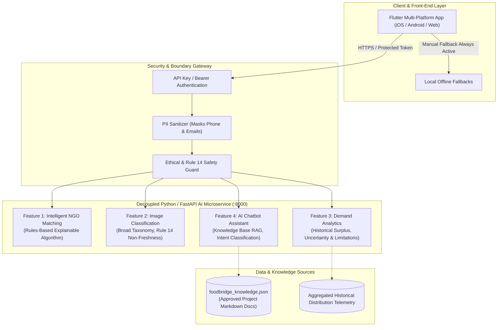

# FoodBridge AI Microservice Architecture Specification
**SDLC Phase 10: AI Integration for FoodBridge**

---

## 1. System Overview & Architectural Topology

FoodBridge adheres to a strict decoupled architecture as defined in **ADR-004** and Section 1 of the System Architecture. The AI capabilities are hosted in an independent, lightweight **Python 3.12 / FastAPI** microservice (`ai_service/`), completely separate from the Flutter client application.

---

## 2. Core Architectural Tenets

1. **Non-Interference with Core Donation Workflow:**
   AI features are strictly advisory. If the AI microservice is offline, unreachable, or errors out, the Flutter application transparently continues with zero interruption using robust local heuristics.
2. **Zero API Key Leakage:**
   Flutter never bundles backend private API keys. Access to the microservice is routed through authorized backend tokens or local reverse proxies.
3. **Mandatory Rule 14 / ADR-004 Compliance:**
   Computer vision models **never** assess freshness, bacterial contamination, or safety. Every category suggestion includes an explicit disclaimer, and any client query requesting food edibility certification is rejected with a `400 Bad Request`.
4. **No Automated Verification or Welfare Eligibility Scoring:**
   AI is strictly barred from automatically approving NGOs (human administrator verification is mandatory for 12A/80G/Darpan documents) or scoring human beneficiary eligibility.

---

## 3. Feature Specifications

### Feature 1: Intelligent NGO Matching (`/api/v1/matching/recommend-ngos`)
Recommends verified recipient NGOs using an explainable, multi-factor rule algorithm:
- **Hard Eligibility Filters:**
  - `is_verified == True` (Unverified NGOs are immediately excluded).
  - `is_available == True` (NGO must be currently operational).
  - `donation.type in candidate.accepted_types` (Matches food vs clothing).
- **Multi-Factor Weighted Scoring:**
  - **30% Service Area Proximity:** Exact zone match (100%), adjacent zone (85%), citywide (65%), remote (30%).
  - **25% Capacity Fit:** $1.0\times - 3.0\times$ ratio scores 100%; supports partial capacity allocation.
  - **20% Storage Capability:** Cold-storage verification for chilled dairy/produce; penalty if cold chain is missing.
  - **15% Urgency & Responsiveness:** High priority bonus for tight collection windows ($\le 2.5$ hours).
  - **10% Type Compatibility:** Food vs clothing category fit.
- **Explainability Output:** Returns transparent breakdown scores and a human-readable justification (e.g. *"Direct operational presence in Swargate • Full quantity capacity available (60/50 meals) • Equipped with certified cold-storage facilities"*).

### Feature 2: Image Classification (`/api/v1/classifier/suggest-category`)
Provides advisory taxonomy suggestions from uploaded image cues or donor hints:
- **Broad Taxonomies:**
  - *Food:* `cooked_meals`, `raw_produce`, `packaged_dry`, `bakery_bread`, `dairy_chilled`.
  - *Clothing:* `kids_clothing`, `adult_clothing`, `winter_thermal`, `blankets_bedding`, `footwear`.
- **Manual Donor Override:** `manual_correction_allowed: true` is always returned.
- **Rule 14 Disclaimer:** Every response attaches the mandatory legal advisory disclaimer.

### Feature 3: Demand Analytics (`/api/v1/analytics/demand-insights`)
Analyses aggregated historical donation telemetry to aid NGO operational planning:
- **Temporal Patterns:** Peak surplus identification (e.g., Lunch Surplus 13:00–15:30; Dinner Surplus 21:30–23:30; Afternoon Troughs).
- **Geographic Insights:** Deficit vs Surplus zone mapping (e.g. Hadapsar fringe high deficit vs Koregaon Park banquet surplus).
- **Seasonal Trends:** Anticipates winter cold waves (+72% blanket requests) and monsoon shelf-stable food shifts.
- **Uncertainty & Limitations Metadata:** Always outputs `sample_size`, statistical confidence interval ($\pm 14.5\%$), and explicit disclaimers regarding unrecorded offline distributions and rural data sparsity.

### Feature 4: AI Chatbot Assistant (`/api/v1/chatbot/query`)
Knowledge-backed assistant assisting users across:
- **Registration & Verification:** Requirements for Donors, NGOs (12A/80G/Darpan IDs), and Volunteers.
- **Donation Publishing:** Step-by-step guidance, temperature categories, allergen warnings, and hygiene charter.
- **NGO Requests:** Concurrency controls, atomic locking, and partial quantity allocation.
- **Volunteer Delivery:** Turn-by-turn route navigation, 2-task active limit, emergency release, and dual-OTP custody verification.
- **App Navigation & Privacy:** Two-tier address privacy policies and role switching.
- **PII Scrubbing:** Automatically scrubs phone numbers and email addresses before query matching.

---

## 4. Endpoints Reference

| Method | Endpoint | Auth | Purpose |
|---|---|---|---|
| `GET` | `/health` | Public | Microservice health, version, and feature status |
| `POST` | `/api/v1/matching/recommend-ngos` | API Key / Bearer | Multi-factor NGO matching with score breakdown |
| `POST` | `/api/v1/classifier/suggest-category` | API Key / Bearer | Broad category classification with Rule 14 guard |
| `POST` | `/api/v1/analytics/demand-insights` | API Key / Bearer | Aggregated demand patterns with uncertainty bounds |
| `POST` | `/api/v1/chatbot/query` | API Key / Bearer | Documentation-backed chatbot assistant with PII scrubbing |

---

## 5. Security & Ethical AI Compliance Checklist

- [x] **Zero Secret Leakage:** Flutter client contains no hardcoded backend API keys.
- [x] **API Key & Bearer Token Authentication:** All privileged endpoints require valid authorization.
- [x] **Rule 14 / ADR-004 Enforcement:** Automated rejection of freshness/edibility certification requests.
- [x] **Human-in-the-Loop NGO Verification:** AI cannot automatically verify NGO credentials; admin console review is mandatory.
- [x] **No Welfare Scoring:** Barred from scoring or evaluating individual beneficiary welfare eligibility.
- [x] **PII Sanitization:** Automated masking of contact numbers and emails before semantic processing.
- [x] **Manual Fallback Guarantees:** Flutter client gracefully defaults to local heuristics if service is offline.
