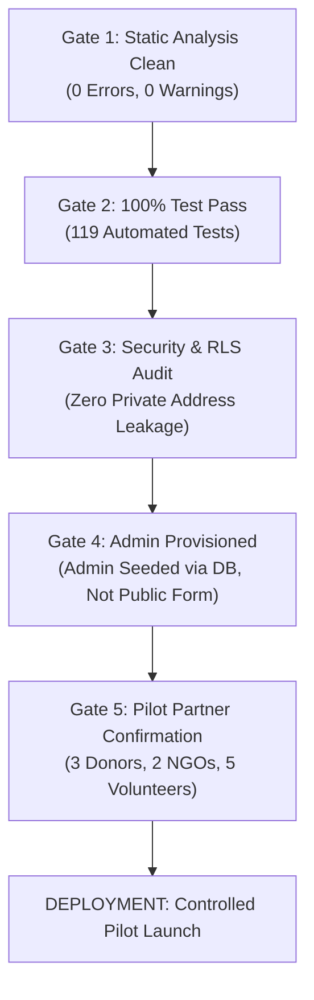

# FoodBridge Production & Pilot Deployment Guide
**SDLC Phase 12: Deployment & Maintenance**

---

## 1. Release Architecture & Readiness Gates

Before promoting FoodBridge to a live controlled pilot, the following quality gates must be satisfied:



---

## 2. Mobile Client Deployment (Android)

### 2.1. Versioning Configuration (`pubspec.yaml`)
Ensure version adheres to semantic versioning:
```yaml
version: 1.0.0+1
```
- `versionName`: `1.0.0` (User-facing marketing release)
- `versionCode`: `1` (Internal Google Play increment integer)

### 2.2. Production Release Build Commands
```bash
# Build standalone release APK for direct pilot distribution
flutter build apk --release --dart-define=APP_ENV=pilot

# Build optimized Android App Bundle (AAB) for Google Play Store
flutter build appbundle --release --dart-define=APP_ENV=production
```

Output locations:
- APK: `build/app/outputs/flutter-apk/app-release.apk`
- AAB: `build/app/outputs/bundle/release/app-release.aab`

---

## 3. Backend & Supabase Configuration

### 3.1. Production Database Hardening
1. **Connection Pooling:** Enable Supabase connection pooling (PgBouncer) on port `6543` in Transaction mode to prevent pool exhaustion during peak donation bursts.
2. **Row Level Security (RLS):** Verify RLS is enabled on all 12 tables using:
   ```sql
   SELECT tablename, rowsecurity FROM pg_tables WHERE schemaname = 'public';
   -- Every row must have rowsecurity = true
   ```
3. **Backup Strategy:**
   - Configure **Daily Automated Snapshots** retained for 30 days.
   - Enable **Point-in-Time Recovery (PITR)** on production instances (enables rollback to any second in preceding 7 days).

### 3.2. Secure Storage Buckets Configuration
1. `donation-photos`:
   - Public read access for thumbnail rendering.
   - Insert policy: `auth.uid() = donor_id`.
   - Max file size: 5 MB per upload.
2. `ngo-verification-docs`:
   - Strictly private bucket (public read = `false`).
   - Read policy: Granted exclusively to users with `role = 'admin'` in `profiles`.

---

## 4. Administrative Access & Account Provisioning

> [!CAUTION]
> **Zero Public Admin Registration:** The public registration screens strictly block administrative role selection. Admin accounts must **never** be provisioned via public client forms.

### Safe Admin Account Provisioning Procedure:
1. Administrator creates a standard account through Supabase Auth dashboard using a secure organizational email.
2. A database superuser executes the following SQL query to grant administrative privileges:
   ```sql
   UPDATE public.profiles
   SET role = 'admin', updated_at = NOW()
   WHERE email = 'admin@foodbridge.org';
   ```
3. The platform audit log records the promotion event:
   ```sql
   INSERT INTO public.audit_logs (actor_id, actor_role, action, target_entity, target_id, details)
   VALUES ('system', 'superuser', 'ADMIN_PROVISIONED', 'profiles', '<user-uuid>', 'Granted admin privileges to admin@foodbridge.org');
   ```

---

## 5. Controlled Pilot Rollout Plan

- **Cohort Size:** 3 commercial donors (restaurants/bakeries), 2 verified local NGO shelters, 5 vetted volunteer riders.
- **Geographic Boundary:** Pune Core Zone (Swargate, Shivajinagar, Kothrud).
- **Monitoring Horizon:** 14-day observation period tracking pickup velocity, expiry prevention, and feedback reports.
- **Rollback Protocol:** In the event of a critical platform halt, the system will switch to manual phone/WhatsApp dispatch using the contact export feature in the Admin Console.

