# FoodBridge — Entity-Relationship Diagram (ERD) & Data Model

**Project:** FoodBridge: Real-Time Food and Clothing Donation & Redistribution Platform  
**Document Version:** 1.0  
**Phase:** Phase 4 — System Architecture and Database Design  
**Status:** Completed  

---

## 1. Visual Entity-Relationship Diagram (ERD)

```mermaid
erDiagram
  PROFILES {
    uuid id PK "Matches auth.users(id)"
    user_role role "donor | ngo | volunteer | admin"
    text display_name "Full name or entity name"
    text phone "Contact phone number"
    account_status account_status "active | pending | suspended"
    text preferred_language "en | hi | mr"
    timestamptz created_at
    timestamptz updated_at
  }

  DONOR_PROFILES {
    uuid user_id PK, FK "References PROFILES(id)"
    text donor_type "restaurant | caterer | individual..."
    text organization_name "Commercial name"
    text default_pickup_area "Public zone"
    text default_pickup_address_private "Encrypted door address"
    text contact_person "Manager or lead name"
  }

  NGOS {
    uuid id PK
    uuid owner_user_id FK "References PROFILES(id)"
    text name "Charity legal name"
    text registration_number UK "Govt 80G/12A/Darpan ID"
    text description "Mission & shelter details"
    text_array service_areas "Zone / Pin code array"
    text capacity_notes "Storage & logistics capacity"
    integer daily_meal_capacity "Max daily meals"
    verification_status verification_status "unverified | pending | verified"
    text_array verification_document_paths "PDF certificate paths"
    text admin_review_notes "Admin feedback"
    timestamptz verified_at
    timestamptz created_at
  }

  VOLUNTEER_PROFILES {
    uuid user_id PK, FK "References PROFILES(id)"
    text vehicle_type "walking | two_wheeler | car | van"
    text_array service_areas "Active patrol zones"
    boolean is_available "Online status toggle"
    integer active_task_limit "Max concurrent tasks (default 2)"
    integer total_completed_trips "Completed dispatches"
  }

  DONATIONS {
    uuid id PK
    uuid donor_id FK "References PROFILES(id)"
    donation_type donation_type "food | clothing"
    text title "Listing title"
    text description "Detailed notes"
    numeric initial_quantity "Total batch quantity"
    numeric available_quantity "Remaining available quantity"
    text unit "kg | boxes | portions | pieces"
    text_array photo_paths "Storage file paths"
    text pickup_area_public "Approximate neighborhood"
    text pickup_location_private "Exact street address"
    text pickup_phone_private "Donor telephone"
    timestamptz available_from
    timestamptz collection_deadline "Mandatory cutoff"
    donation_status status "available | requested | accepted..."
    timestamptz created_at
    timestamptz updated_at
  }

  FOOD_DETAILS {
    uuid donation_id PK, FK "References DONATIONS(id)"
    food_category food_category "cooked_meals | packaged..."
    timestamptz prepared_or_packed_at "Preparation time"
    storage_condition storage_condition "hot_holding | ambient..."
    text allergen_notes "Known allergen disclosures"
    boolean donor_safety_declaration "Mandatory true"
    integer estimated_servings "Approx meal portion count"
  }

  CLOTHING_DETAILS {
    uuid donation_id PK, FK "References DONATIONS(id)"
    clothing_category item_category "menswear | winterwear..."
    clothing_condition condition "new | gently_used | good"
    text_array size_range "S | M | L | XL..."
    boolean cleanliness_declaration "Mandatory true"
  }

  DONATION_REQUESTS {
    uuid id PK
    uuid donation_id FK "References DONATIONS(id)"
    uuid ngo_id FK "References NGOS(id)"
    numeric requested_quantity "Quantity requested"
    boolean requires_volunteer_delivery "Direct vs volunteer"
    text message "Coordinator note"
    request_status status "pending | approved | fulfilled..."
    text decision_note "Approval/Rejection note"
    timestamptz created_at
    timestamptz updated_at
  }

  ASSIGNMENTS {
    uuid id PK
    uuid donation_request_id FK "References DONATION_REQUESTS(id)"
    uuid volunteer_id FK "References VOLUNTEER_PROFILES(user_id)"
    timestamptz pickup_window_start
    timestamptz pickup_window_end
    assignment_status status "open | assigned | picked_up..."
    timestamptz picked_up_at
    timestamptz delivered_at
    text rejection_reason "Doorstep refusal notes"
    timestamptz created_at
    timestamptz updated_at
  }

  DISTRIBUTION_RECORDS {
    uuid id PK
    uuid donation_id FK "References DONATIONS(id)"
    uuid ngo_id FK "References NGOS(id)"
    numeric quantity_received "Actual kg/pieces accepted"
    numeric quantity_distributed "Delivered to community"
    integer beneficiaries_served_count "Number of meals/persons"
    text unit "Measurement unit"
    date distribution_date "Distribution day"
    text summary_notes "Community distribution summary"
    timestamptz created_at
  }

  NOTIFICATIONS {
    uuid id PK
    uuid recipient_user_id FK "References PROFILES(id)"
    text event_type "donation_requested | task_ready..."
    text title "Alert header"
    text body "Alert message"
    text entity_type "donation | assignment"
    uuid entity_id "Target entity id"
    timestamptz read_at
    timestamptz created_at
  }

  AUDIT_LOGS {
    uuid id PK
    uuid actor_user_id FK "References PROFILES(id)"
    text action "STATUS_CHANGE | VERIFY_NGO..."
    text entity_type "Table or resource name"
    uuid entity_id "Modified row id"
    jsonb old_state "Prior state snapshot"
    jsonb new_state "New state snapshot"
    inet ip_address "Origin IP"
    timestamptz created_at
  }

  PROFILES ||--o| DONOR_PROFILES : "extends"
  PROFILES ||--o| VOLUNTEER_PROFILES : "extends"
  PROFILES ||--o{ NGOS : "manages"
  PROFILES ||--o{ DONATIONS : "publishes"
  DONATIONS ||--o| FOOD_DETAILS : "specializes"
  DONATIONS ||--o| CLOTHING_DETAILS : "specializes"
  DONATIONS ||--o{ DONATION_REQUESTS : "receives"
  NGOS ||--o{ DONATION_REQUESTS : "submits"
  DONATION_REQUESTS ||--o| ASSIGNMENTS : "triggers"
  VOLUNTEER_PROFILES ||--o{ ASSIGNMENTS : "fulfills"
  DONATIONS ||--o{ DISTRIBUTION_RECORDS : "concludes_with"
  NGOS ||--o{ DISTRIBUTION_RECORDS : "records"
  PROFILES ||--o{ NOTIFICATIONS : "receives"
  PROFILES ||--o{ AUDIT_LOGS : "causes"
```

---

## 2. Cardinality & Referential Integrity Rules

1. **`PROFILES` $\rightarrow$ `DONOR_PROFILES` / `VOLUNTEER_PROFILES` ($1:0..1$):**
   - Each authenticated profile optionally extends into exactly one specialized role table based on their registered role. Cascades delete on user account removal.
2. **`PROFILES` $\rightarrow$ `NGOS` ($1:0..N$):**
   - An NGO representative owns their organization record. Deletion is restricted (`ON DELETE RESTRICT`) to preserve historical legal traceability.
3. **`DONATIONS` $\rightarrow$ `FOOD_DETAILS` / `CLOTHING_DETAILS` ($1:1$ Exclusive):**
   - A donation has exactly one child record matching its `donation_type`. Cascades delete on donation withdrawal.
4. **`DONATIONS` $\rightarrow$ `DONATION_REQUESTS` ($1:0..N$):**
   - Multiple NGOs may request a donation, but sum of `requested_quantity` across approved requests cannot exceed `initial_quantity`.
5. **`DONATION_REQUESTS` $\rightarrow$ `ASSIGNMENTS` ($1:0..1$):**
   - An approved request requiring volunteer transport creates exactly one dispatch task in `ASSIGNMENTS`.
6. **`ASSIGNMENTS` $\rightarrow$ `VOLUNTEER_PROFILES` ($N:0..1$):**
   - A dispatch task has at most one active volunteer assigned (`NULL` when `open`). Cascades to `SET NULL` if a volunteer profile is deactivated.
7. **`DONATIONS` $\rightarrow$ `DISTRIBUTION_RECORDS` ($1:0..N$):**
   - Documents final handover and distribution outcomes. Zero direct personal identifiers of community beneficiaries.

