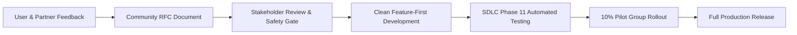

# FoodBridge Maintenance, Operations & Reliability Policy
**SDLC Phase 12: Deployment & Maintenance**

---

## 1. Error Monitoring & Telemetry

### 1.1. Client-Side Crash & Error Tracking
- **Tooling:** Sentry / Firebase Crashlytics.
- **Error Capture:** Uncaught asynchronous exceptions are routed through `FlutterError.onError` and `PlatformDispatcher.instance.onError`.
- **Alert Thresholds:**
  - $> 1\%$ crash-free session drop triggers an immediate high-priority developer pager alert.
  - Repeated network timeouts on pickup/delivery confirmation (> 5 occurrences in 15 minutes) trigger dispatch operations alerts.

### 1.2. Server & Microservice Health
- **Uptime Monitoring:** External monitoring daemon pings `GET /health` every 60 seconds.
- **Log Aggregation:** Supabase Logflare / CloudWatch captures API gateway latencies, 4xx/5xx status spikes, and database slow queries (> 200 ms).

---

## 2. Backup & Disaster Recovery Strategy

| Layer | Backup Mechanism | Frequency | Retention | RPO / RTO |
|---|---|---|---|---|
| **Database (PostgreSQL)** | Automated Full Snapshot | Daily at 02:00 UTC | 30 Days | RPO: 24h / RTO: 30 min |
| **Point-in-Time Recovery (PITR)** | WAL (Write-Ahead Log) Archival | Continuous streaming | 7 Days | RPO: $< 1$ minute / RTO: 15 min |
| **Storage Buckets (Photos & Docs)** | Versioned Object Storage | Continuous versioning | Indefinite | RPO: 0 / RTO: Immediate |
| **Microservice Code & Models** | Git repository tags & Docker registry | Every release tag | Permanent | RPO: 0 / RTO: 10 min |

- **Disaster Recovery Drills:** The engineering team conducts simulated database restoration drills quarterly to ensure backup integrity and team operational readiness.

---

## 3. Security Updates & Vulnerability Management

1. **Dependency Audit Cadence:**
   - Flutter dependencies: Run `flutter pub outdated` and `dart pub audit` bi-weekly.
   - Python dependencies: Run `pip-audit` and Dependabot vulnerability scanning on every pull request.
2. **Secret & Key Rotation:**
   - Supabase JWT secrets and AI microservice `FOODBRIDGE_AI_API_KEY` rotated every 90 days.
   - Android release keystores stored in secure hardware security modules (HSM) / cloud secret managers; never committed to git.
3. **Database Access Review:**
   - Monthly audit of PostgreSQL Row Level Security (RLS) policies to verify zero accidental privilege escalation.

---

## 4. User Feedback Collection & Quality Loops

1. **In-App Rating & Logistics Feedback:**
   - Upon completing a handover, volunteers and NGOs can submit quick logistics feedback (packaging quality, waiting time, navigation accuracy).
2. **Monthly NGO Advisory Council:**
   - Partner shelters and food banks meet monthly with the operations team to review distribution metrics and capacity bottlenecks.
3. **Complaint Workflows:**
   - Built-in community complaint reporting system in the app routes directly to the administrator console for rapid investigation.

---

## 5. Incident Management Protocol

### 5.1. Incident Severity Tiers
- **SEV-1 (Critical Emergency):** Core donation lifecycle halted (e.g. inability to claim food or confirm OTP handover); security breach or address leak. Response SLA: **$< 15$ minutes**.
- **SEV-2 (Major Impairment):** Non-blocking failure affecting a subset of users (e.g., AI microservice offline, notifications delayed). Response SLA: **$< 1$ hour**.
- **SEV-3 (Minor Glitch):** Cosmetic UI defects or minor translation typos. Response SLA: **Next scheduled sprint**.

### 5.2. Post-Mortem SLA
- For all SEV-1 and SEV-2 incidents, a formal blameless post-mortem report must be published within **72 hours**, detailing root cause, timeline, remediation actions, and preventative architectural changes.

---

## 6. Continuous Feature Improvement Process

All new capabilities must undergo the complete SDLC validation pipeline, ensuring the core donation and food safety workflows remain 100% stable and regression-free.
