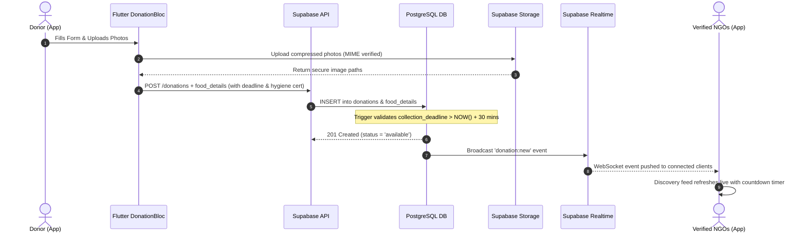
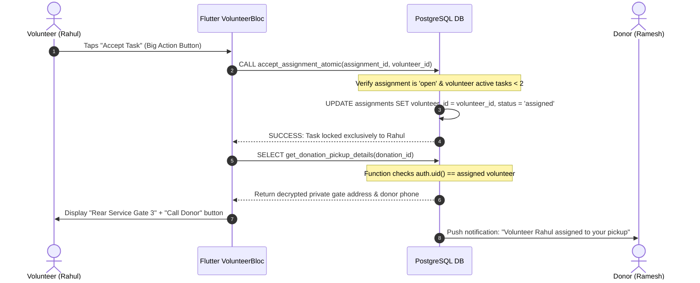

# FoodBridge — System Architecture & Modular Design Specification

**Project:** FoodBridge: Real-Time Food and Clothing Donation & Redistribution Platform  
**Document Version:** 1.0  
**Phase:** Phase 4 — System Architecture and Database Design  
**Status:** Completed  

---

## 1. High-Level Architecture Overview

FoodBridge is engineered as a **modular monolith** on the backend using Supabase (PostgreSQL, Supabase Auth, Supabase Realtime, and Supabase Storage), paired with a **Flutter multi-platform client** and a decoupled, optional **Python/FastAPI AI microservice** (deferred to Phase 10).

```
┌────────────────────────────────────────────────────────────────────────┐
│                        FLUTTER CLIENT APPLICATION                      │
│   (Android Native Mobile Primary | Web Adaptive for Admin Console)     │
└─────────────┬──────────────────────────┬───────────────────────────────┘
              │ HTTPS / REST (PostgREST) │ WebSockets (Realtime)
              ▼                          ▼
┌────────────────────────────────────────────────────────────────────────┐
│                        SUPABASE CLOUD PLATFORM                         │
│  ┌──────────────────────┐  ┌─────────────────────┐  ┌───────────────┐  │
│  │    Supabase Auth     │  │  PostgreSQL 15+ DB  │  │  Supabase RT  │  │
│  │ (JWT, RBAC, Sessions)│  │ (RLS, Triggers, SPs)│  │  (WebSockets) │  │
│  └──────────────────────┘  └──────────┬──────────┘  └───────────────┘  │
│                                       │                                │
│                            ┌──────────▼──────────┐                     │
│                            │  Supabase Storage   │                     │
│                            │ (Photos, NGO Proofs)│                     │
│                            └─────────────────────┘                     │
└───────────────────────────────────────┬────────────────────────────────┘
                                        │ Secure API Tokens
                                        ▼
                         ┌─────────────────────────────┐
                         │  OPTIONAL AI MICROSERVICE   │
                         │   (Python 3.11 + FastAPI)   │
                         │ • Advisory Category Suggest │
                         │ • Proximity Matching Scores │
                         └─────────────────────────────┘
```

---

## 2. Client Clean Architecture Specification

The Flutter client adheres strictly to **Clean Architecture** principles coupled with a **Feature-First folder structure**. This separates user interface, business logic, domain models, and external data sources into decoupled layers.

```
lib/
├── core/                               # Cross-cutting foundational infrastructure
│   ├── config/                         # Environment constants, Supabase keys, endpoints
│   ├── errors/                         # App exceptions, failures, error handling
│   ├── network/                        # HTTP client wrappers, connectivity observers
│   ├── theme/                          # Design tokens, color palette, light/dark themes
│   ├── utils/                          # Date formatters, validators, geo calculations
│   └── widgets/                        # Shared reusable UI components (Buttons, Cards, Chips)
│
├── data/                               # Shared data infrastructure & global models
│   ├── datasources/                    # Supabase client singleton, local storage wrappers
│   └── models/                         # Shared DTOs, base response models
│
└── features/                           # Feature-First Modular Domain Slices
    ├── authentication/                 # Sign-in, sign-up, password reset, session persistence
    │   ├── data/                       # AuthRepositoryImpl, SupabaseAuthDataSource
    │   ├── domain/                     # Entities (User, Session), UseCases (Login, Register)
    │   └── presentation/               # Controllers/Providers, LoginScreen, RegisterScreen
    │
    ├── onboarding/                     # Splash screen, role selector, onboarding carousel
    ├── donor/                          # Donor dashboard, my donations, impact summaries
    ├── donations/                      # Create food/clothing donation forms, photo uploads
    ├── ngo/                            # NGO dashboard, discovery feed, claim requests, distribution
    ├── volunteer/                      # Volunteer dashboard, available task feed, active delivery
    ├── assignments/                    # Task lifecycle, pickup confirmation, handover verify
    ├── notifications/                  # In-app notification center, realtime stream listeners
    ├── profile/                        # User profiles, vehicle settings, language switcher
    └── admin/                          # Verification queue, user moderation, audit logs
```

### Layer Separation Boundaries
1. **Domain Layer (Innermost — Pure Dart):**
   - **Entities:** Pure business objects without database or JSON dependencies.
   - **Repository Interfaces:** Abstract contracts defining data operations.
   - **Use Cases (Interactors):** Single-responsibility business transactions (e.g., `CreateFoodDonationUseCase`, `ClaimDonationUseCase`).
2. **Data Layer (Middle — Infrastructure):**
   - **Models (DTOs):** Extend domain entities with `fromJson` and `toJson` serialization.
   - **Data Sources:** Direct interactions with Supabase Client (`supabase.from('donations')`).
   - **Repository Implementations:** Implement domain interfaces, handling error translation and local caching.
3. **Presentation Layer (Outermost — Flutter UI):**
   - **State Controllers / ViewModels:** Riverpod or BLoC managing screen state, event handling, and side effects.
   - **Screens & Widgets:** Declarative Flutter UI widgets listening to immutable states.

---

## 3. End-to-End Sequence & Data Flow Diagrams

### 3.1 Sequence 1: Food Donation Publishing & Realtime Broadcast


### 3.2 Sequence 2: Atomic NGO Reservation & Race Condition Prevention
```mermaid
sequenceDiagram
  autonumber
  actor NGO1 as NGO A
  actor NGO2 as NGO B
  participant DB as PostgreSQL DB

  Note over NGO1, NGO2: Both attempt to claim the last 30 kg simultaneously
  NGO1->>DB: CALL claim_donation_atomic(id, 30kg, ngo_a)
  NGO2->>DB: CALL claim_donation_atomic(id, 30kg, ngo_b)
  Note over DB: DB executes first transaction with row lock (SELECT FOR UPDATE)
  DB->>DB: Lock donation row; verify available_quantity >= 30kg
  DB->>DB: Decrement available_quantity to 0; status = 'requested'
  DB->>DB: Insert into donation_requests (status = 'pending')
  DB-->>NGO1: SUCCESS: Request recorded, quantity reserved
  Note over DB: Lock released; second transaction evaluates
  DB->>DB: Verify available_quantity >= 30kg (Now 0)
  DB-->>NGO2: ERROR 409: Requested quantity no longer available
```

### 3.3 Sequence 3: Volunteer Task Claim & Private Address Revelation


### 3.4 Sequence 4: Pickup, Handover & Distribution Logging
```mermaid
sequenceDiagram
  autonumber
  actor Vol as Volunteer
  actor NGO as NGO Receiver
  participant DB as PostgreSQL DB

  Vol->>DB: UPDATE assignments SET status = 'picked_up'
  DB-->>Vol: Haptic tap confirmed; in-transit timer starts
  Vol->>DB: Arrives at shelter; UPDATE assignments SET status = 'delivered_to_ngo'
  NGO->>DB: Physical inspection passed; confirms receipt
  NGO->>DB: INSERT into distribution_records (quantity_distributed, meal_count)
  Note over DB: Prohibits beneficiary PII at schema level
  DB->>DB: UPDATE donations SET status = 'completed'
  DB-->>Vol: "Task closed! Thank you."
  DB-->>NGO: "Distribution logged."
```

