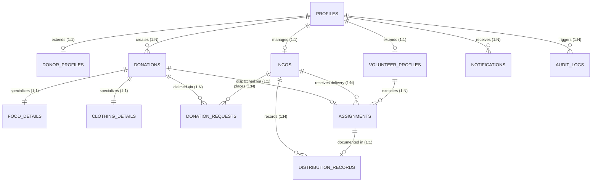

# FoodBridge Database Relationships & ERD

## 1. Entity Relationship Diagram (ERD)

---

## 2. Cardinality & Integrity Rules

### 2.1 Profile Specialization (1:1)
- `profiles` ➔ `donor_profiles`: Optional 1:1. Created when a profile is granted the `donor` role. Cascade delete on profile deletion.
- `profiles` ➔ `ngos`: Optional 1:1. Represents legal entity status. `user_id` has a unique constraint.
- `profiles` ➔ `volunteer_profiles`: Optional 1:1. Maintains volunteer operational states (online status, active tasks).

### 2.2 Polymorphic Donation Extension (1:1 Exclusive Subtypes)
- `donations` ➔ `food_details`: 1:1 extension. Enforced by database trigger when `donations.type = 'food'`. Cascade delete on donation deletion.
- `donations` ➔ `clothing_details`: 1:1 extension. Enforced when `donations.type = 'clothing'`.

### 2.3 Claims & Single-Exclusive Dispatch (1:1)
- `donations` ➔ `assignments`: **Strictly 1:1 unique constraint on `donation_id`**. This database constraint prevents multiple dispatches for the same physical donation parcel.
- `assignments` ➔ `distribution_records`: 1:1 post-delivery record verifying actual meal portions or clothing units distributed.

---

## 3. Referential Action Matrix

| Parent Table | Child Table | Foreign Key Column | On Delete Action | Justification |
|---|---|---|---|---|
| `auth.users` | `profiles` | `id` | `CASCADE` | User account purge removes application profile |
| `profiles` | `donations` | `donor_id` | `RESTRICT` | Cannot delete donor profile while historical donation records exist |
| `donations` | `assignments` | `donation_id` | `CASCADE` | Cancelling donation cleans up active assignment |
| `profiles` | `assignments` | `volunteer_id` | `SET NULL` | Removing a volunteer unlinks assignment for re-dispatch |
| `ngos` | `assignments` | `ngo_id` | `CASCADE` | NGO closure handles active incoming orders |

