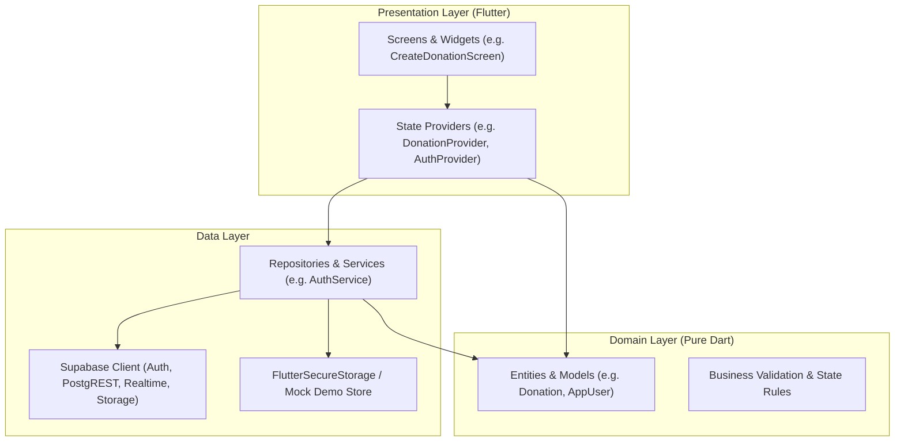

# FoodBridge Flutter Technical Architecture

## 1. Architectural Style: Clean Architecture & Feature-First Structure

FoodBridge implements **Clean Architecture** with a **Feature-First** modular decomposition. This decouples user interface rendering from domain rules and underlying data persistence (Supabase, local cache).

```
lib/
├── core/
│   ├── config/              # Environment variables, constants (EnvConfig)
│   ├── errors/              # Typed exception hierarchy (AppException)
│   ├── localization/        # Multi-language manager (LocaleProvider)
│   ├── router/              # Declarative GoRouter configuration (AppRouter)
│   ├── theme/               # Material 3 Theme, AppColors, AppTypography
│   ├── utils/               # AppLogger, date/time formatters, validators
│   └── widgets/             # Reusable UI system (FBButton, FBTextField, FBStatusChip)
└── features/
    ├── admin/               # Admin verification queue & system audit
    ├── authentication/      # Supabase Auth, User models, AuthProvider
    ├── donations/           # Domain models, DonationProvider, detail views
    ├── donor/               # Donor dashboard, CreateDonationScreen (Food & Cloth)
    ├── ngo/                 # NGO feed, claim bottom sheets, verification
    ├── notifications/       # Real-time alert notifications center
    ├── onboarding/          # Splash and role selection screens
    ├── profile/             # Profile settings, demo role switcher
    └── volunteer/           # Rider Mode, vehicle dispatch feeds, 1-touch actions
```

---

## 2. Layer Responsibilities



1. **Presentation Layer:**
   - Flutter Widgets strictly handle layout, user input, and animations.
   - Reactive state managed via `ChangeNotifier` (`Provider`).
   - Declarative navigation via `GoRouter`.
2. **Domain Layer:**
   - Free from Flutter framework dependencies.
   - Houses plain Dart models (`AppUser`, `Donation`), enums (`UserRole`, `DonationType`, `DonationStatus`), and pure business rules.
3. **Data Layer:**
   - `AuthService` and future data sources encapsulate Supabase client calls.
   - Supports compile-time environment switching (`EnvConfig.isConfigured`) to seamlessly switch between live Supabase endpoints and local in-memory stores for offline testing.

---

## 3. State Management (Provider & ChangeNotifier)
- **`AuthProvider`:** Manages authentication token lifecycle, active user profile, role authorization, and switching.
- **`DonationProvider`:** Manages donation state collections, search and category filtering, atomic status transitions, and computed impact counters.
- **`ThemeProvider` & `LocaleProvider`:** Manage application-wide visual theme (Light / Dark) and localized active language (`en`, `hi`, `mr`).

---

## 4. Error Handling Hierarchy
All application errors inherit from `AppException`:
- `NetworkException`: Offline state, timeouts, DNS failures.
- `AuthException`: Invalid credentials, expired session, unauthorized role access.
- `ValidationException`: Input formatting, FSSAI declaration missing, deadline invalid.
- `ServerException`: Supabase RPC failures, database lock contention.
