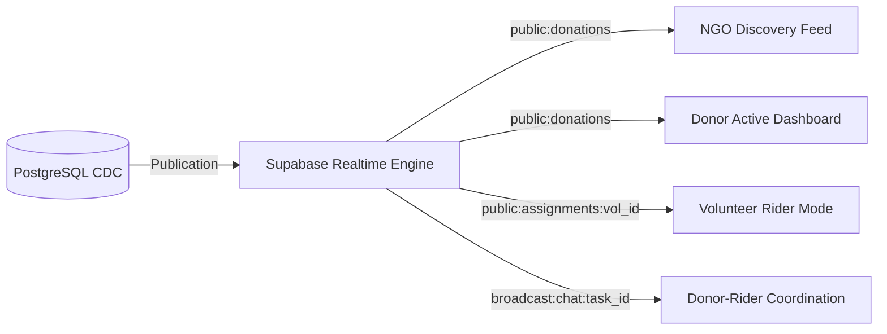

# FoodBridge Supabase Realtime Architecture

## 1. Overview
FoodBridge utilizes **Supabase Realtime** (powered by Phoenix WebSockets and PostgreSQL Change Data Capture / Logical Replication) to broadcast immediate updates to Donors, NGOs, and Volunteer Riders without battery-draining client polling.

---

## 2. Channels & Event Subscriptions



### 2.1 Channel: `public:donations`
- **Topic:** `donations-feed`
- **Events:**
  - `INSERT`: New food or clothing donation listed. Triggers immediate UI card insertion on NGO explore feed within a 10km radius.
  - `UPDATE`: Status changes (`listed` ➔ `claimed` ➔ `assigned` ➔ `delivered`).
  - `DELETE`: Listing withdrawn or purged.
- **Payload Schema:**
  ```json
  {
    "event": "UPDATE",
    "table": "donations",
    "old": { "id": "dn-101", "status": "listed" },
    "new": { "id": "dn-101", "status": "claimed", "updated_at": "2026-11-12T16:00:00Z" }
  }
  ```

### 2.2 Channel: `user-dispatches:<volunteer_id>`
- **Topic:** `volunteer-assignments`
- **Events:**
  - `ASSIGNMENT_AVAILABLE`: Broadcasts to all online riders in the zone when an NGO claims a donation that needs a delivery courier.
  - `ASSIGNMENT_LOCKED`: Broadcasts when another rider locks the task, immediately clearing it from other riders' feeds.

### 2.3 Channel: `user-notifications:<user_id>`
- **Topic:** `in-app-notifications`
- **Events:**
  - `NOTIFICATION_CREATED`: Triggers in-app snackbar alert and increments badge counter on the top app bar.

---

## 3. Flutter Client Subscription Implementation
```dart
void subscribeToDonationFeed(Function(Donation) onUpdate) {
  Supabase.instance.client
      .channel('public:donations')
      .onPostgresChanges(
        event: PostgresChangeEvent.all,
        schema: 'public',
        table: 'donations',
        callback: (payload) {
          final updated = Donation.fromJson(payload.newRecord);
          onUpdate(updated);
        },
      )
      .subscribe();
}
```
