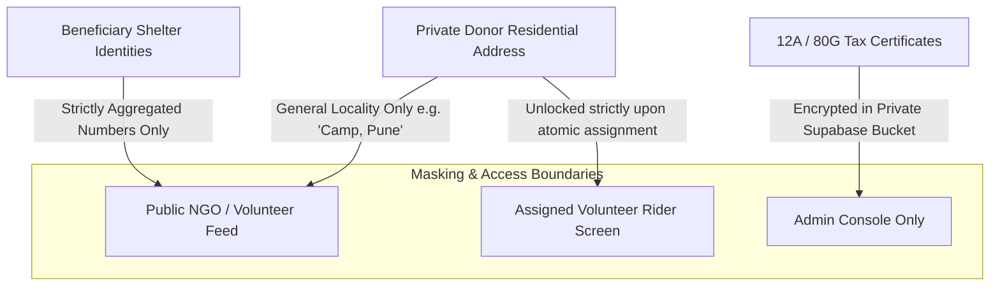

# FoodBridge Security Architecture & Data Privacy

## 1. Zero-Trust Security Philosophy
FoodBridge enforces a **Zero-Trust Client** architecture. The Flutter mobile and web applications are considered untrusted execution environments. No security, role authorization, or business constraint check is delegated solely to client-side code:
1. Every write operation is validated via server-side PostgreSQL RLS policies or `SECURITY DEFINER` RPC functions.
2. User roles are tied directly to authenticated JWT claims verified on every PostgreSQL query.
3. Database mutations generate immutable audit logs (`audit_logs` table).

---

## 2. Privacy & PII Protection Guidelines

### 2.1 Private Donor Address Masking
- **Before Assignment:** While a donation is `listed` or `claimed`, the public API and NGO feed only display the general locality / area (e.g., *"Camp, Pune (~3.5 km away)"*).
- **After Assignment:** The precise building, flat number, and contact phone are unlocked strictly for the single volunteer assigned to the task (`assignments.volunteer_id = auth.uid()`).

### 2.2 Complete Beneficiary Privacy (Zero PII)
- To protect the human dignity and safety of vulnerable populations in shelters, the platform **never collects, stores, or transmits individual beneficiary names, photographs, or biometric details**.
- Distribution records only capture aggregated headcount metrics (e.g., *75 meal boxes distributed at Swargate Shelter*).

### 2.3 NGO Verification Document Isolation
- Registration certificates, 80G tax exemption proofs, and Trust deeds uploaded to Supabase Storage are housed in a private bucket (`ngo-credentials`).
- Pre-signed read URLs with short expiry (15 minutes) are generated exclusively for platform administrators during verification review.

---

## 3. Food Safety & AI Limitations
- **Mandatory Safety Rule:** Under no circumstances will Artificial Intelligence (AI) models or computer vision be permitted to certify food safety or declare food fit for consumption.
- **Truth In Declaration:** Donors must legally declare food hygiene, cooking timestamp, and holding temperature compliance under the Food Safety and Standards Act (FSSAI).
- **Urgent Expiry System:** Any cooked food donation reaching its safe consumption deadline is automatically transitioned to `expired` by a background database cron trigger.

---

## 4. Audit Log Immutability
- The `audit_logs` table has no `UPDATE` or `DELETE` policies defined for any user or role.
- All administrative approvals, status transitions, and emergency task cancellations are cryptographically tied to the authenticated user ID and client IP address.
