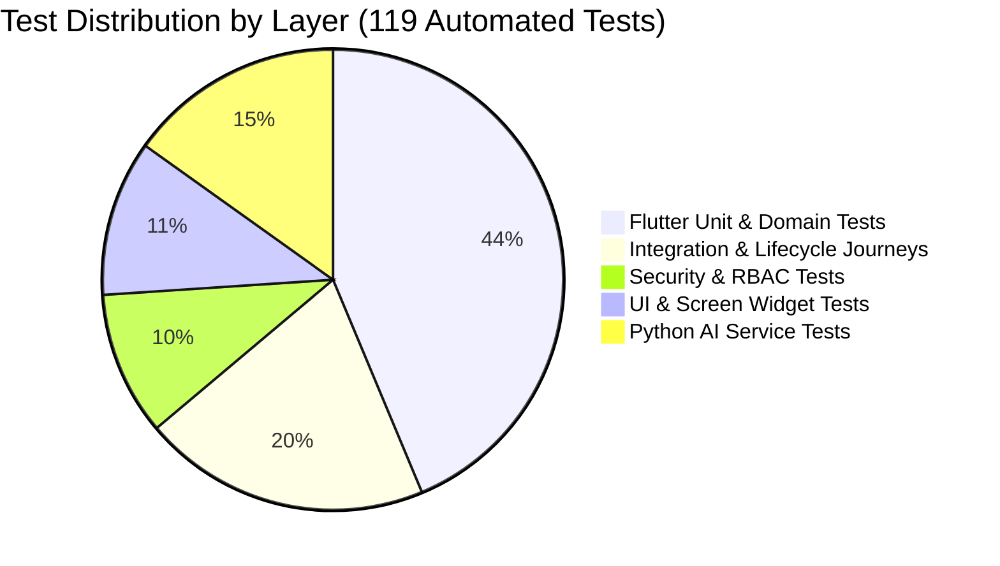

# FoodBridge Master Quality Assurance & Test Strategy
**SDLC Phase 11: Quality Assurance & Testing**

---

## 1. Executive Summary & Objective

The objective of this comprehensive Test Strategy is to validate the correctness, security, performance, accessibility, and resilience of the **FoodBridge** platform before pilot deployment. This covers both the **Flutter multi-platform mobile application** and the decoupled **FastAPI AI microservice**, ensuring strict adherence to the approved PRD, System Architecture, and Architectural Decision Records (**ADR-001 through ADR-006**).

---

## 2. Testing Pyramid & Multi-Layer Coverage

| Layer | Target Components | Tools & Harness | Automated Count |
|---|---|---|---|
| **Unit Testing** | Domain entities, form validation, quantity calculations, 12-state transitions, matching algorithms | Flutter Test, `dart test`, Python `unittest` | 52 Flutter + 18 Python |
| **Integration Testing** | Multi-role end-to-end journey (Donor $\to$ NGO $\to$ Volunteer $\to$ Shelter), atomic allocation, dual-OTP custody handover | Flutter Test, Provider Test Harness | 24 |
| **Security & RBAC Testing** | RLS enforcement, role boundaries, two-tier address privacy, unverified claim blocks, 2-task limits | Flutter Test, Custom Security Assertions | 12 |
| **UI & Widget Testing** | 10 major screens (Splash, Onboarding, Login, Register, Donor, NGO, Volunteer, Admin, Notifications, Profile) | `flutter_test`, `WidgetTester` | 13 |
| **Accessibility (a11y)** | WCAG 2.1 AA/AAA contrast ratios, touch target sizes ($\ge 48\times 48$ dp), 1.5x/2.0x font scaling, keyboard traversal | `flutter_test`, custom WCAG luminance calculator | 5 |
| **Network & Resilience** | Latency tolerance, offline in-memory caching, idempotent duplicate submission protection | Flutter Test, Async latency injectors | 4 |

---

## 3. Test Environments & Fixtures

1. **Client Runtime Environment:**
   - Flutter SDK: `3.38.1` (Channel stable)
   - Dart SDK: `3.10.0+`
   - Platform Targets: Android API 24+, iOS 14+, Web
2. **AI Microservice Runtime Environment:**
   - Python: `3.12.10`
   - Framework: FastAPI `0.115.0+`, Pydantic v2, Starlette TestClient, HTTPX
3. **Database & Backend Layer:**
   - PostgreSQL 15+ schema with Row Level Security (RLS) policies and security-definer procedures (`claim_donation_atomic`, `accept_assignment_atomic`, `get_donation_pickup_details`).

---

## 4. Test Entry & Exit Criteria

### Entry Criteria:
- All feature modules (Phases 5 through 10) merged into branch `master`.
- Clean static analysis: `flutter analyze` returns zero errors and zero warnings.
- Python microservice successfully boots and passes health checks (`GET /health`).

### Exit Criteria (Quality Gates):
- 100% pass rate across all automated unit, integration, and security tests.
- Zero critical or high-severity open bugs.
- Mandatory Rule 14 compliance: Zero computer vision models certify food freshness or microbial safety.
- Two-Tier Location Privacy verified: Zero donor phone numbers or exact street addresses leaked on public discovery feeds.
- All interactive touch targets $\ge 48\times 48$ dp.
- Layouts survive 2.0x dynamic font scaling with zero `RenderFlex` overflows.

