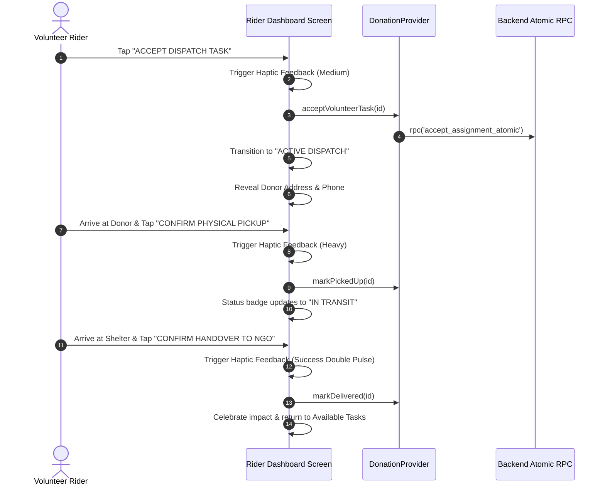

# FoodBridge Interaction Design Specification

## 1. Interaction Principles
1. **Zero-Friction In The Field:** Critical operational interactions (especially for delivery riders and shelter coordinators) must be executable with single-hand gestures, high-contrast visual cues, and tactile confirmation.
2. **Optimistic Updates With Rollback:** When a volunteer accepts a task or confirms a pickup, the UI updates instantaneously. If the atomic backend transaction encounters a network exception, the state smoothly rolls back with an informative snackbar alert.
3. **Preventive Confirmation:** Irreversible decisions (such as claiming a large quantity of cooked food or cancelling a listing) require explicit confirmation dialogs highlighting the specific responsibility and time commitment.

---

## 2. Micro-Interactions & Gestures

### 2.1 Rider 1-Touch Status Progression

### 2.2 Feed Pull-to-Refresh
- Uses a smooth `RefreshIndicator` with `AppColors.primaryGreen`.
- Fetches real-time diffs from Supabase or cached collection.

### 2.3 Status Chip Transition Animation
- When a donation transitions between states (`listed` ➔ `claimed` ➔ `assigned`), the `FBStatusChip` executes a 250ms cross-fade and scale animation (`Curves.easeOutCubic`) rather than an abrupt visual jump.

---

## 3. Feedback & Error Recovery Flows

### 3.1 Network Loss & Offline Reconnection
- An in-app status banner appears at the top: *"You are offline. Active task navigation data is cached locally."*
- Form submissions queue locally and auto-retry upon connectivity restoration.

### 3.2 Race Condition Handling (Concurrent Claim)
- When two NGOs attempt to claim the same food listing simultaneously:
  1. The first request commits via PostgreSQL row-level lock (`claim_donation_atomic`).
  2. The second request returns a `DonationAlreadyClaimedException`.
  3. The losing client displays a polite toast: *"This surplus was just claimed by another shelter nearby. Refreshing available listings..."* and refreshes the feed.

