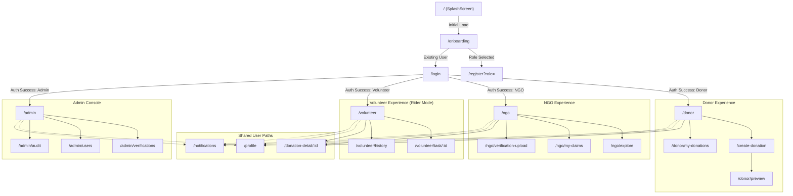

# FoodBridge Navigation Architecture & Sitemap

## Route Specifications Table

| Path | Screen Class | Access Level | Description |
|---|---|---|---|
| `/` | `SplashScreen` | Public | Brand reveal & auth token validation |
| `/onboarding` | `OnboardingScreen` | Public | Role selection & value proposition intro |
| `/login` | `LoginScreen` | Public | Email/Password login + role selector |
| `/register` | `RegisterScreen` | Public | Role registration + safety charter check |
| `/donor` | `DonorDashboardScreen` | Role: Donor | Live listings, quick actions, impact metrics |
| `/create-donation` | `CreateDonationScreen` | Role: Donor | Food & Clothing listing multi-category form |
| `/donation-detail/:id` | `DonationDetailScreen` | Authenticated | Detail card with contextual role actions |
| `/ngo` | `NgoDashboardScreen` | Role: NGO | Filtered discovery feed & claim actions |
| `/volunteer` | `VolunteerDashboardScreen` | Role: Volunteer | Rider mode dispatch feed & 1-tap progress |
| `/admin` | `AdminDashboardScreen` | Role: Admin | NGO verification queue & audit activity |
| `/profile` | `ProfileScreen` | Authenticated | Account details, theme & language switches |
| `/notifications` | `NotificationsScreen` | Authenticated | In-app notification center |

## Route Guards & Role Protection
1. **Unauthenticated Redirect:** Any request attempting to access `/donor`, `/ngo`, `/volunteer`, or `/admin` without an active session is redirected to `/login`.
2. **Role Boundaries:** When a user navigates to a role dashboard not matching their profile, `AppRouter` redirects them to their designated home screen or surfaces an authorized switch prompt.
3. **Demo Fallback:** In prototype mode, the role switcher in `ProfileScreen` allows switching active simulated roles for testing.

